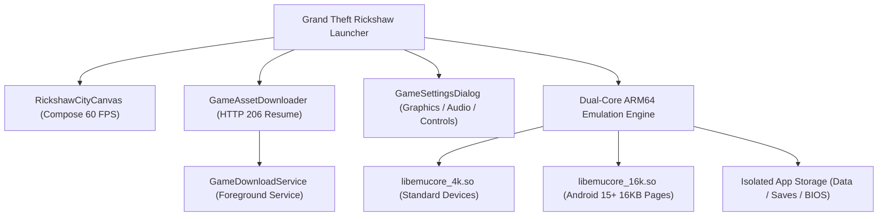

# Grand Theft Rickshaw: Open World 🛺💨

[](LICENSE)
[-brightgreen.svg)](https://developer.android.com)
[](https://kotlinlang.org)
[](https://developer.android.com/jetpack/compose)
[](https://developer.android.com/guide/practices/page-sizes)
[](https://haryanvideveloper.com)

**Grand Theft Rickshaw: Open World** is a dedicated, standalone mobile gaming title published by **Haryanvi Developer**. It transforms high-performance ARM64 emulation technology into an integrated, console-quality mobile game experience.

The app completely eliminates the technical "emulator frontend" feel—players are greeted with an immersive landscape title screen, procedural Cyberpunk night city artwork, in-game performance settings, automated asset delivery, and instant one-tap gameplay.

Official Website: **[https://haryanvideveloper.com](https://haryanvideveloper.com)**

---

## 🌟 Key Features

### 🎮 Standalone AAA Mobile Experience
- **Zero Emulator Complexities**: No PCSX2 menus, technical graphics hacks, BIOS path pickers, or raw memory card directories exposed to players.
- **Cinematic Landscape Display**: Launches and remains permanently in wide landscape orientation (`sensorLandscape`) with edge-to-edge UI.
- **Procedural Animated Canvas Artwork**: Custom 60 FPS background (`RickshawCityCanvas`) featuring:
  - Deep violet-indigo night skyline with illuminated skyscraper windows.
  - Perspective highway with dynamic neon speed lines and cyan road curbs.
  - Stylized **Golden-Green Auto-Rickshaw** with pulsating dual LED headlight beams and cyan underglow.

### ⚙️ Dedicated In-Game Settings Modal
- **One-Tap Graphics Presets**:
  - **Smooth (1x Native)**: 30 FPS battery-saver mode optimized for 4 GB RAM devices.
  - **Balanced (1.5x HD)**: 45–60 FPS crisp 720p resolution (Recommended).
  - **Ultra (2.0x 1080p)**: Maximum visual fidelity at 60 FPS.
- **Master Audio Controls**: Responsive master volume slider (0–100%) and instant mute toggle.
- **Controls & Haptics**: Toggle virtual on-screen driving buttons and dynamic vibration/haptic feedback.
- **Clean Hardware Status**: Non-intrusive status readout (Dual-Core ARM64, 4.21 GB data, fast engine state).

### ℹ️ Player Info & Compatibility Modal
- **Player Mode**: 1 Player Offline Story Mode & Free Roam.
- **Supported Controls**:
  - Dynamic on-screen virtual steering & action controls.
  - Sony PlayStation DualSense & DualShock 4.
  - Microsoft Xbox Wireless Controllers.
  - Mobile gaming rigs: Razer Kishi, Backbone One, Gamesir.
- **Attribution & Licenses**: Fully accessible in-game licensing disclosures for complete legal transparency.

### 📥 Integrated Asset Pipeline (PUBG / Mobile Style)
- **Automatic Asset Detection**: Checks for open-world game data on launch.
- **Live Download HUD**: Displays download progress bar, percentage, real-time speed (MB/s), and downloaded size.
- **Background Download Service**: Includes a **"Continue in Background"** option backed by an Android Foreground Service (`GameDownloadService`), ensuring 4.2 GB downloads complete even when the user switches apps.
- **HTTP Range Resume**: Supports HTTP 206 Partial Content to seamlessly resume interrupted downloads without losing progress.
- **Instant "PLAY GAME"**: Once assets are verified, a glowing emerald button activates to boot directly into the game. Supports instant **"RESUME LAST SAVE"** if a previous save slot is detected.

---

## 📱 Hardware & System Requirements

| Specification | Minimum | Recommended |
|---|---|---|
| **Architecture** | 64-bit ARM64 (`arm64-v8a`) | 64-bit ARM64 (`arm64-v8a`) |
| **Operating System** | Android 10 (API Level 29) | Android 12+ (API Level 31+) |
| **RAM** | 4 GB | 6 GB or higher |
| **Processor** | Snapdragon 720G / Dimensity 800 | Snapdragon 870 / Dimensity 1200 or newer |
| **Storage** | 5 GB free internal storage | High-speed UFS 2.2 / 3.1 storage |
| **Page Size Support** | 4 KiB | 4 KiB & 16 KiB (Android 15+ compatible) |

---

## 🛠️ Architecture & Tech Stack



- **User Interface**: Kotlin 2.0, Jetpack Compose, Material 3, Navigation Compose.
- **Background Services**: Android Foreground Service with live notification progress channels.
- **Native Emulation Engine**: PCSX2-derived C++ core compiled via CMake with Clang and Android NDK.
- **Memory Page Alignment**: Dual native compilation delivering both 4 KiB and 16 KiB libraries (`libemucore_4k.so`, `libemucore_16k.so`) for forward compatibility with Google Play's Android 15 requirements.
- **Audio & Input**: SDL3 native input dispatching, low-latency audio streaming, and OpenSL/Oboe backends.

---

## 🚀 Building from Source

### Prerequisites
- **Android Studio**: Ladybug (2024.2) or later recommended.
- **Android SDK**: Compile SDK `37`, Target SDK `37` (or `35`), Minimum SDK `29`.
- **Android NDK**: Version `29.0.14206865`.
- **CMake**: Version `3.22.1` or newer.
- **Java Development Kit**: JDK 17, 21, or 25 (set as `JAVA_HOME`).

### 1. Clone the Repository with Submodules
```bash
git clone --recursive https://github.com/HaryanviDeveloper/grand-theft-rickshaw.git
cd grand-theft-rickshaw
```
*(If cloned without submodules, run: `git submodule update --init --recursive`)*

### 2. Configure Local Properties
Create or edit `local.properties` in the project root:
```properties
sdk.dir=C:\\Users\\YOUR_USER\\AppData\\Local\\Android\\Sdk
# Optional: Set custom download URL or AdMob IDs
# game.downloadUrl=https://your-server.com/game-assets.iso
# admob.appId=ca-app-pub-YOUR_APP_ID
```

### 3. Build Debug APK
```powershell
$env:JAVA_HOME = "C:\Program Files\Android\Android Studio\jbr"
.\gradlew.bat assembleDebug
```
The output APK will be generated at:
`app/build/outputs/apk/debug/app-debug.apk`

### 4. Build Release App Bundle (for Google Play)
```powershell
$env:JAVA_HOME = "C:\Program Files\Android\Android Studio\jbr"
.\gradlew.bat bundleRelease
```
The output AAB will be generated at:
`app/build/outputs/bundle/release/app-release.aab`

### 5. Run Unit Tests
```powershell
.\gradlew.bat testDebugUnitTest
```

---

## ⚖️ Legal & Licensing Disclaimers

### Open Source Licensing (GNU GPLv3)
This project incorporates open-source emulation technologies derived from **EmuCoreX** and **PCSX2**. 
In accordance with the **GNU General Public License v3.0 (GPLv3)**:
- This software is free and open-source.
- The complete corresponding source code is published and made available in this repository.
- A full copy of the license is included in the [LICENSE](LICENSE) file.

### Intellectual Property & BIOS Notice
- Proprietary PlayStation 2 BIOS firmware and commercial game images are **not** distributed within this repository for public releases.
- In compliance with Google Play Store Developer Policies and international copyright law, players must obtain their own BIOS and game software legally from their own original game media.

### Trademark Notice
- *PlayStation*, *PlayStation 2*, *PS2*, *DualShock*, and *DualSense* are registered trademarks of **Sony Interactive Entertainment Inc.**
- *Grand Theft Auto* is a registered trademark of **Take-Two Interactive Software, Inc. / Rockstar Games**.
- This project is an independent parody and open-source game launcher developed by **Haryanvi Developer**. It is not affiliated with, endorsed, sponsored, or certified by Sony Interactive Entertainment Inc., Take-Two Interactive, or Rockstar Games.

---

## 👨‍💻 Publisher & Contact

- **Studio / Publisher**: Haryanvi Developer
- **Official Website**: [https://haryanvideveloper.com](https://haryanvideveloper.com)
- **Support & Inquiries**: contact@haryanvideveloper.com
- **License**: [GNU General Public License v3.0](LICENSE)
